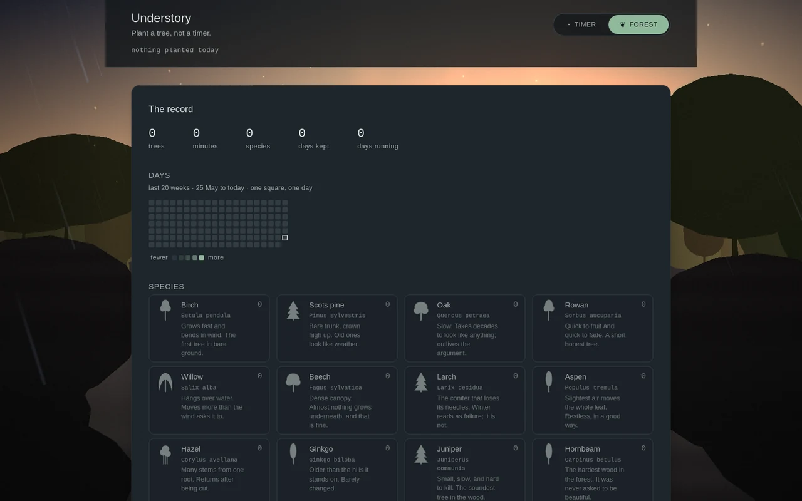
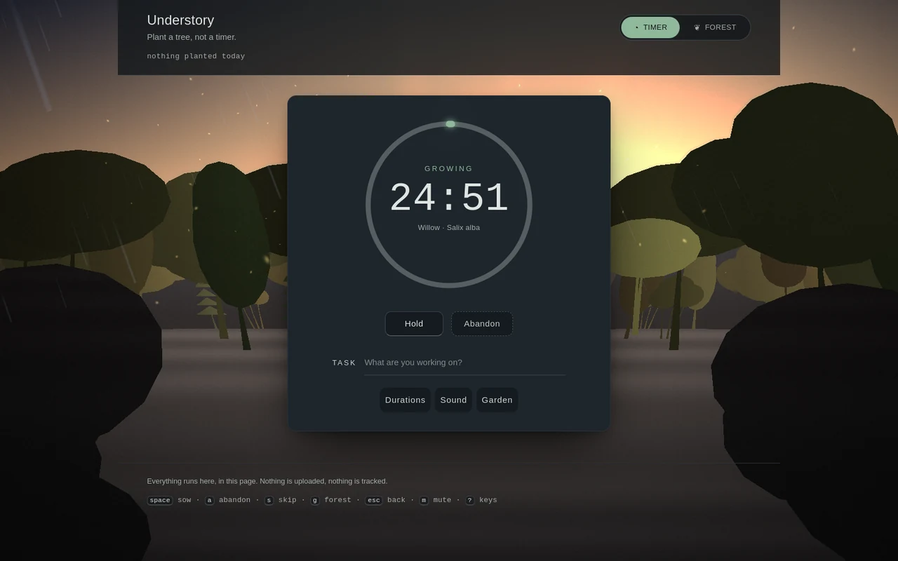
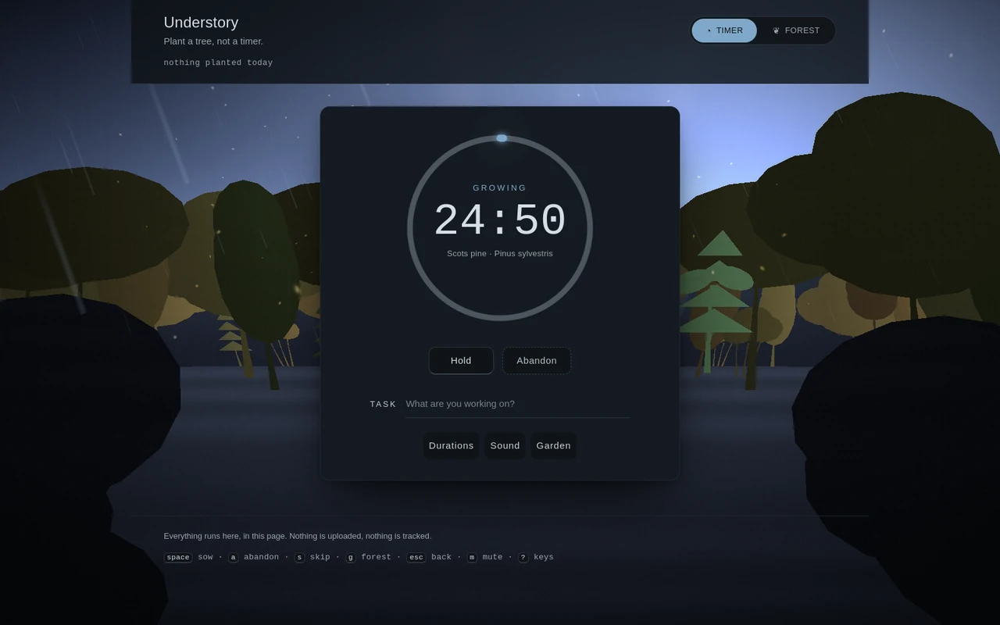
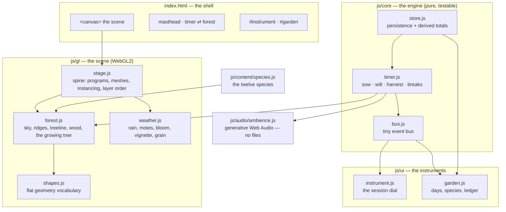

<div align="center">

# Understory

**Plant a tree, not a timer.**

A study forest. You don't set twenty-five minutes — you sow a tree. It grows in real time while you
work, wilts if you walk away, and takes its place in a forest that accumulates across days. Rain,
wind and light are drawn live, in the page, from nothing.

[](.) &nbsp;
[](.) &nbsp;
[](.) &nbsp;
[](LICENSE)



</div>

## The idea

A pomodoro timer asks you to obey a clock. Understory asks you to keep something alive. The timer is
still there — focus, short break, long break, the fourth one long — but the thing you are watching is
a tree, and the thing you are building is a wood.

It plays the part of the promise: **the tree you are growing is the biggest living thing on screen**,
it catches the light as it grows, and when the session ends it stays in the forest whether you
finished honestly or walked away.

<div align="center">
 
</div>

Three palettes, chosen from the clock: **dusk**, **night**, **dawn**. The page reads the local hour
and paints itself to match — no setting to find.

## Running it

There is no install, no build and no dependency. It is a folder of files.

```sh
git clone https://github.com/fevnem/understory && cd understory
node serve.mjs . 8150        # or: python3 -m http.server 8150
# open http://127.0.0.1:8150/
```

`serve.mjs` (25 lines, no dependencies) sends `Cache-Control: no-store`, so a reload can never mix a
cached old script with new HTML. Any static server works — that one just refuses to lie to you.

## How it is put together

No bundler, no framework, no `node_modules`. ES modules loaded straight by the browser, one WebGL2
canvas, and state in `localStorage`.



| layer | file | what lives there |
|---|---|---|
| engine | `js/core/timer.js` | focus / short / long, the 90s pause grace, outcomes `harvested` · `wild` · `distracted` · `wilted`, restore across a reload |
| state | `js/core/store.js` | one schema, sanitised on load, totals derived rather than stored |
| scene | `js/gl/stage.js` | WebGL2 spine — programs, meshes, instance buffers, layer order, post slot, and a CSS-only fallback when there is no WebGL2 |
| scene | `js/gl/forest.js` | gradient sky, two hazy ridges, a silhouette treeline, a lit ground plane, three depth rows of trees, corner foliage, and the tree being grown |
| scene | `js/gl/weather.js` | drizzle with depth-graded alpha, drifting motes, light shafts, bloom, vignette, grain |
| sound | `js/audio/ambience.js` | generative soundscape built from oscillators — no audio files, and never before a real gesture |
| ui | `js/ui/instrument.js`, `js/ui/garden.js` | the dial, the day grid, the species ledger |

### The scene is illustration, not 3D

It began as procedural low-poly 3D and it looked like programmer art. It is now a **layered
illustrated silhouette landscape** drawn as flat 2D geometry in normalised screen space. Depth comes
from stacking, not from a camera: each layer sits lower, darker and crisper than the one behind.

A silhouette scene lives or dies on its **tonal ladder** — the sky must be brighter than every layer
in front of it, stepping down cleanly: far ridge → mid ridge → treeline → trees → ground → framing.
The palette is chosen by hand per theme; deriving it from CSS tokens produced a muddy near-black
scene twice.

## The gate

```sh
node tools/verify.mjs              # everything
node tools/verify.mjs --only forest
```

`tools/verify.mjs` drives a **real headless Chromium over raw CDP** and grades the contract rather
than the source: the pomodoro engine's phases and outcomes, session restore across a reload, hotkeys,
reduced-motion honesty, **zero off-origin requests**, byte budgets, no horizontal overflow at four
widths, the frame budget (measured two ways — frame gap and callback work), and each module's own
evidence from its live `stats()`.

The steps poll for the state they assert instead of trusting a fixed sleep. A timed step on a slow
software rasteriser fails intermittently and drags every later step down with it.

## Keys

| key | |
|---|---|
| <kbd>space</kbd> | sow a tree · hold · resume |
| <kbd>a</kbd> | abandon it — the tree wilts |
| <kbd>s</kbd> | skip the rest |
| <kbd>g</kbd> | forest / timer |
| <kbd>esc</kbd> | back to the timer |
| <kbd>m</kbd> | mute everything |
| <kbd>?</kbd> | the key sheet |

## Design rules

Zero dependencies, zero build, zero off-origin requests. Escape-then-tag for anything a user types.
Audio only after a real gesture. Reduced motion is honoured rather than overridden. The interface is
quiet on purpose: one accent colour, no gamification, no confetti — the forest is the feedback.

Nothing is uploaded and nothing is tracked. Your trees live in `localStorage` on your own machine.

## Licence

MIT © 2026 Rakib Hasan
